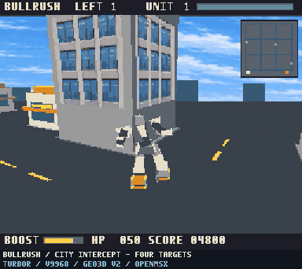

# BULLRUSH / CITY INTERCEPT — 4敵・無制限パトロール試作

**v0.2.2：ローラーと足装甲の隠れ方を修正しました。** 停止時に片側だけ大きく見えた問題へ対応しています。左右の寸法・ポリゴン数・関節モーションは維持しています。

[修正内容・比較画像・検証結果](docs/ROLLER_FIX.md)。描画精度のため追加処理があり、同条件の固定場面で約15→12更新/秒となるケースが残ります。多くの比較場面は約12更新/秒を維持しました。速度優先で旧版を試したい場合は、保全している[v0.2.1](https://github.com/kanon-ai/BULLRUSH/releases/tag/v0.2.1)を利用できます。


MSX turboR + V9968 + Geo3D V2.0向けのプレイ可能な市街地追跡ゲーム試作です。ローラーダッシュ・横スライド・旋回で街を走り、盗まれた4機を近接戦闘で停止させます。完成版ではなく、実験的なプレリリースです。

盗まれた4機すべてを追跡し、接近して停止させてください。敵は個別にHP100を持ち、発砲してきます。時間制限はなく、自機HPがなくなると敗北です。全4機を破壊しても勝利画面には移らず、残骸を残した街を自由に走れます。自動補充はありません。全滅後に再開したい場合はエミュレータをリセットします。

## ROMの選択・起動

両版とも **4 MiB ASCII16 / MSX turboR・R800 + V9968 + Geo3D V2.0（1024エントリー）専用** です。

|構成|使用するROM|VDP / Geo3Dポート|
|---|---|---|
|外付けV9968カートリッジ|`BULLRUSH-CITY-INTERCEPT-EXTERNAL-88H.ROM`|88h–8Ch / 8Dh・8Fh|
|内蔵VDP置換構成|`BULLRUSH-CITY-INTERCEPT-INTERNAL-98H.ROM`|98h–9Ch / 9Dh・9Fh|

[Releases](https://github.com/kanon-ai/BULLRUSH/releases)から、自分の構成と一致するROMを選んでください。自動検出・自動切替ではありません。外付け版は外付けV9968側の映像出力を表示します。本体内蔵VDPの出力だけを見てもゲーム画面は表示されません。Geo3D V1、別のポート設定、標準openMSXには対応していません。

**両版とも作者版openMSX commit `67811936bee936c15e3fbdbdffe01755fd349876`で確認。実機・FPGA・BlueMSX+では未検証です。** 現行のあらゆるボード/FPGA構成で動作する保証はありません。BIOS・エミュレータ・FPGAデータは同梱しません。

### 外付け版（88h）

作者版openMSXの `Panasonic_FS-A1ST` + `HRA_V9968` + `geo3d88` を使用します。拡張はこの順で読み込み、映像出力は `V9968` を選びます。ランチャーが出力を切り替えます。

```text
python run.py --external-88h --openmsx "対応版openmsx.exeのパス"
```

### 内蔵版（98h）

`Panasonic_FS-A1ST_V9968` + `geo3d` を使用します。

```text
python run.py --openmsx "対応版openmsx.exeのパス"
```

Windowsでは `PLAY.cmd` に同じ引数を渡せます。`BULLRUSH_OPENMSX` 環境変数で実行ファイルを指定することもできます。両構成の設定は別のruntimeフォルダに保存します。

両版のSHA256、ポート移植と検証範囲は [docs/IO_VARIANTS.md](docs/IO_VARIANTS.md) を参照してください。

## 操作

|キー|動作|
|---|---|
|Enter|開始／敗北画面からリトライ|
|↑ / W|前進・加速|
|↓ / S|減速・後退|
|← → / A D|左旋回・右旋回|
|Q / E|左・右へ横スライド|
|Shift|ブースト。ゲージ消費、非使用時回復|
|Space|近距離打撃。長押しでクールダウンごとに攻撃|
|C|追尾／コックピット切替|
|T|建物・空のテクスチャON/OFF|
|P|一時停止／復帰|
|M|効果音のミュート切替|


## 戦闘と表示

- 青3機・赤1機の全4敵に独立した耐久値と破壊状態があります。自機は元の白い警察機です。
- パンチは各軸200ワールド単位未満の近接判定。高いジャンプ中の元の標的は除外します。方向判定は設けず、重なりを広めに拾います。1振りにつき同じ敵へ25ダメージを1回だけ与え、複数敵が重なっていればそれぞれに命中します。長押しでクールダウン後に次のパンチを出します。
- ダッシュ体当たりは15ダメージ。パンチ動作中は体当たりを重ねません。攻撃やクールダウンの長さは元版同様フレーム単位です。
- 命中した敵側に約0.55秒の3D破片を表示。破壊後は頭部・腕・装甲を倒した形状と車輪が残り、位置を保ちます。残骸は進路を塞ぎません。遠距離では描画を省きますが、戻れば同じ場所にあります。
- 敵は約2.5秒ごとに近くの自機を狙い、発射時の位置へ撃ちます。約0.38秒後の着弾範囲から移動すれば回避できます。命中で自機HPが10減り、約0.6秒は連続被弾を防ぎます。建物越しの射撃抑制は中間点の簡易判定です。
- `LEFT` は残敵数、`UNIT` と上部バーは最寄りの生存敵の番号・HP。下部 `HP` は自機HPです。レーダーには全敵を表示し、橙が選択対象、灰色の小さい点は残骸です。
- 時間制限・ヘリコプター演出はありません。自機HPゼロで停止し、Enterで全機・HP・残骸を初期化して再挑戦できます。

## 描画と軽量化

元の56棟・4×4交差点・自機24姿勢・車輪・256×212表示領域・配色を継承しました。静的頂点/面/UV常駐、回転行列の整数テーブル、HUD固定部分の再利用を継続。同じ比較交換順を保った短い機械語ルーチンで奥行きソートを行い、不要な繰り返し読み出しと通常HUDの文字転送を減らしています。倒れた装甲も常駐モデルで、破片は敵ごとに1モデルへまとめました。

建物とロボ本体は物体単位の描画順です。v0.2.2では各ローラーと対応する足先装甲をまとめ、Geo3Dの面単位ソートで重なりを処理します。汎用Zバッファや関節IKではありません。近接・交差状態では局所的な前後関係の限界があります。4機の経路・攻撃はCPUで更新し、プレイヤー移動はキー操作です。

## 検証の読み方

`docs/validation.json` は最終ROMの通常キー操作による全4敵破壊、150秒超継続、残骸保持、自機被弾敗北・再挑戦、操作切替を記録します。開発時の独立した診断では位置を書き換え、単独/重なり命中、1振りの多重ヒット防止、破壊形状の多方向確認に使用します。診断結果を通常プレイ実績とは扱いません。

速度比較は `docs/comparison.json`。旧にぎやか最適化版・追加実装時・最終版を同じ固定視点/キー操作で比較し、同速に留まる場面も記載します。エミュレーション時間基準であり、実機速度ではありません。Geo3D幾何処理は完全なサイクル精度モデルではなく、実機の最大性能を示しません。

GIF/MP4は実行時の等速で、早送りやフレーム補間はありません。BGMなし、元のPSG効果音はMで切替できます。

## ソースビルド

検証したビルド環境はWindows、Python 3.13.5、NumPy 2.4.6、Pillow 12.2.0、SDCC 4.6.0 #16555です。`SDCC_BIN` にコンパイラのbinフォルダを設定します（未指定時はPATHから検索）。Windows実行ファイル名を使用するビルドスクリプトです。SDCC配布物によってはcc1をcc1.exeとして配置する必要があります。

```text
python -m pip install -r requirements.txt
python build.py --rebuild-assets
python build_io.py
```

`build_io.py` は `out/` に両方の名前付きROMを生成します。外付け版は専用コピー内でI/O命令・CのSFR指定・HUD用インラインアセンブリのポートのみを変更して再コンパイルします。元ソースと内蔵版は保持します。

原型デモの素材生成コードも収録し、既存ROMなしで再生成できます。公開用ソースからの再ビルドでも配布ROMとのSHA256一致を確認しています。検証条件は [docs/RELEASE_VALIDATION.md](docs/RELEASE_VALIDATION.md) を参照してください。

## ライセンス・免責

本プロジェクトのコードはMIT Licenseです。ROMにリンクされたSDCCランタイムにはGPL-2.0-or-laterとSDCCリンク例外が適用され、MITへ変更するものではありません。[THIRD_PARTY_NOTICES.md](THIRD_PARTY_NOTICES.md) を参照してください。AI素材の来歴は `assets/PROVENANCE.md`。BIOS、エミュレータ、FPGAデータ、コンパイラ、フォントファイルは配布しません。

現状有姿・無保証の試作です。実機動作・安全性・性能・将来の仕様との互換性を保証せず、各ハード/エミュレータ開発者による承認や性能保証を意味しません。利用は利用者の判断と責任で行ってください。

## v0.2.0～v0.2.1の比較記録（2026-11-01）

|条件|旧にぎやか版|4敵機能追加版|最終軽量化版|
|---|---:|---:|---:|
|同じ通常キー操作・平均更新/秒|13.23|12.01|12.43|
|6固定視点・更新/秒|約11.98|約11.98|11.98–14.98|
|4機同時ヒット粒子・更新/秒|機能なし|9.99–11.98|約11.98|
|20msのSpace入力|20/20|20/20|20/20|

追加版に対して通常操作で約3.4%改善しましたが、戦闘機能増加のため旧版より約6.1%低下しています。同速の固定場面もあります。機能追加版と最終版は、粒子4機同時表示・全残骸状態でも同条件で測定し、全画素一致を確認しています。通常の6視点では旧版ともHUD/レーダー以外の全画素が一致しました。

短いプロファイルでCPU側の座標準備が最大の負荷でした。ソートは元Cループと198回の結果一致を確認。`docs/profile-summary.json` のGeo待ち・VDP待ちは各処理時間に含まれる内訳で、再加算はできません。動画の速度変更で改善を見せてはいません。

## レーダーの色

|表示|意味|
|---|---|
|白寄りのクリーム色・3×3点|自機|
|橙色・3×3点|選択中の生存敵。上部UNIT番号/HPバーに対応|
|青灰色・3×3点|その他の生存敵|
|灰色・2×2点|破壊後の残骸|
|暗い青の格子|道路の位置|

選択は原則として最寄りの生存敵へ自動で切り替わります。UNIT1が従来の青機、UNIT2が赤機、UNIT3/4が追加青機です。近い点は重なります。通常キー操作186サンプルで選択対応を確認し、色は専用の位置固定診断画面で検証しました（docs/radar-validation.json）。

## Preview / English quick start



Experimental playable city pursuit game for MSX turboR/R800 + V9968 + Geo3D V2 (separate internal 98h and external 88h I/O editions). Four enemies, melee combat, persistent wrecks, unlimited patrol after clearing all enemies. 4 MiB ASCII16 ROM. Enter starts/retries; arrows or WASD drive; Q/E strafe; Shift boosts; Space punches; C changes camera; T toggles textures; P pauses; M mutes effects. No BGM.

Tested only with the developer Geo3D V2 openMSX build identified above. Standard openMSX and Geo3D V1 are not supported; hardware, FPGA and BlueMSX+ are unverified. Emulator performance is not a hardware benchmark. Original project code: MIT; linked SDCC runtime: GPL with linking exception. AI-generated texture rights are granted only to the extent held. Provided as is, without warranty or endorsement by hardware/emulator developers.

再ビルドROMの起動確認: `python run.py --openmsx "対応版openmsx.exeのパス" --rom out/BULLRUSH-CITY-INTERCEPT.ROM --script tests/smoke.tcl`（先にビルド）。

外付け版の起動確認には `--external-88h --rom out/BULLRUSH-CITY-INTERCEPT-EXTERNAL-88H.ROM --script tests/io-smoke.tcl` を指定してください。
