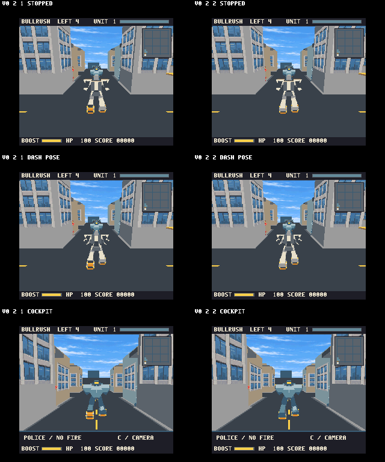

# v0.2.2 — ローラー／足装甲の描画順修正

停止状態で左右ローラーが不揃いに見える問題を修正しました。旧版は奥の車輪、機体全体、手前の車輪の順に描いており、片側は装甲に隠れ、反対側は装甲を上書きしていました。遠近感だけが原因ではありません。

## 変更範囲

各足のローラーと足先装甲を1つの面ソート対象にまとめました。Geo3Dに車輪と足装甲を別々の変換行列で投影させ、投影済み頂点を保持して両者の面を奥行き順に描きます。本体から外した足装甲の面をここで描くため、面を増減したり車輪を小さくしたりしていません。

自機・青機・赤機に適用し、既存の倒れた残骸形状は保持します。姿勢変換済みデータの再利用と白・青・赤の面情報常駐で、毎フレームの転送を減らしました。整数丸めで単純な左右平行移動にならない姿勢は、元の右足頂点・面を使います。車輪の寸法24×28×28、元の頂点、24姿勢、回転テーブルは保全確認済みです。

Geo3Dの使用量は頂点936/1024、面1014/1024です。面ソートであり、汎用Zバッファになったわけではありません。建物や機体全体の交差など、物体単位ソートの限界は残ります。

## 比較画像

左がv0.2.1、右がv0.2.2。停止、ダッシュ姿勢、コックピットの順です。画面はエミュレータの実描画で、固定比較には診断用RAM設定を使っています。

## 検証と処理速度

作者版openMSX commit `67811936bee936c15e3fbdbdffe01755fd349876`、R800構成で検証しました。

- 内蔵98h・外付け88h両版で、通常キー入力のみの4敵撃破、180秒までの自由走行、残骸位置保持を確認。
- 両版の走行・横移動・旋回・P/C/T切替、内蔵版の被弾敗北と再挑戦を確認。
- 停止・走行姿勢・旋回・追尾・コックピットを比較。旧版と異なる描画は足周辺で確認しました。
- 元の頂点・姿勢・回転データをバイナリ比較。戦闘・敵経路・HPルールは変更していません。
- キャッシュROMなしの公開ソースから再生成し、配布ROMと一致。両I/O版の差は108個のポート指定のみ。

固定6場面の旧→新更新/秒は `12→12、12→11.5、15→12、12→12、12→12、12→12` でした。各2秒の完了フレーム数なので、0.5刻みの値はフレーム境界を含みます。**約15→12の低下は残っており、速度向上版とは位置づけません。** 初回実装にあったコックピット12→10の低下は、常駐化後に12へ回復しました。

同じ25秒のキー入力では旧12.44、新12.84更新/秒でした。ただし経過時間で動くため、通過位置や見える物体が完全一致する比較ではありません。全面的な高速化を示す値ではありません。詳細は [roller-validation.json](roller-validation.json)。

**実機・FPGA・BlueMSX+は未検証です。** Geo3Dの幾何処理時間を完全にはモデル化しないエミュレータの測定であり、実機性能を保証しません。旧v0.2.1リリースを保全しています。

## ROM SHA256

- INTERNAL-98H: `b5938c2d3676734ef8d75b687fee2db14667f28b93a37675d747b8a5f4cb863c`
- EXTERNAL-88H: `4a4ec0f07b1b49fe4ab0c8e674fcea1fc8c29e5c690b2fe5b0ac7a1174b56ca2`

Each foot now depth-sorts its roller and boot faces together. Geometry, poses and wheel dimensions are retained. Both I/O editions passed developer-openMSX input/combat tests; hardware and BlueMSX+ remain unverified. Some scenes are slower (15 to12 updates/s); this is an occlusion correction, not a speedup release.
